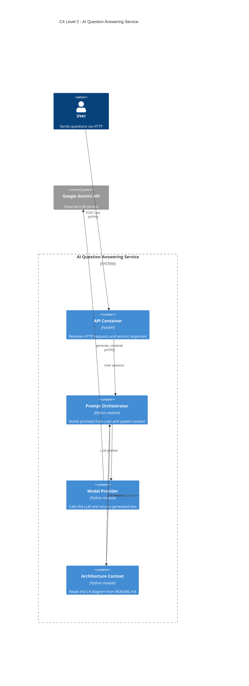

# AI Question Answering Service

## Architecture


[](https://github.com/YessineT/ai-architecture-nextwork/actions/workflows/architecture.yml)

## Purpose

This project shows how to build an AI service whose **architecture, code, and automation all tell the same story**. The system is designed first as a C4 Level 2 diagram, implemented as a FastAPI service that calls Google Gemini, and then protected by a GitHub Actions check that fails if the code drifts from the design.

## What It Does

- **`POST /ask`**: accepts a question and returns a concise answer from Gemini.
- **`POST /ask-architecture`**: answers questions about the system itself, grounded in the C4 diagram from this README, so the design is the evidence behind each answer.
- **`GET /health`**: confirms the server is running without calling Gemini.
- **Architecture check**: `check_architecture.py` reads the container aliases in the diagram and verifies that a matching Python module exists for each one. CI runs it on every push and pull request.

## How the Diagram Maps to Code

| Container | File | Responsibility |
| --- | --- | --- |
| API Container | `main.py` | Receives HTTP requests, returns responses, and talks only to the orchestrator |
| Prompt Orchestrator | `orchestrator.py` | Builds prompts from user input and system context |
| Model Provider | `model_provider.py` | The only module that calls Gemini; turns provider failures into a 502 |
| Architecture Context | `architecture_context.py` | Extracts the Mermaid diagram from this README for grounded answers |

## Request Flow

1. The user sends a question to the API.
2. `main.py` passes it to the orchestrator.
3. The orchestrator builds the prompt, adding the C4 diagram for architecture questions.
4. `model_provider.py` sends the prompt to Gemini and returns the generated text.

## Running Locally

```bash
python -m venv venv
source venv/bin/activate        # Windows: .\venv\Scripts\Activate.ps1
pip install -r requirements.txt
echo "GEMINI_API_KEY=your-api-key-here" > .env
fastapi dev main.py
```

Then try it:

```bash
curl -X POST http://127.0.0.1:8000/ask \
  -H "Content-Type: application/json" \
  -d '{"question": "What is the C4 model?"}'

curl -X POST http://127.0.0.1:8000/ask-architecture \
  -H "Content-Type: application/json" \
  -d '{"question": "Which module calls Gemini?"}'
```

Interactive API docs are available at `http://127.0.0.1:8000/docs`.

## Architecture Enforcement

```bash
python check_architecture.py
```

If a container in the diagram has no matching module, the check prints `Architecture drift detected` and exits with an error. The GitHub Actions workflow runs the same script, so a pull request can't merge a design the code doesn't implement. The badge at the top shows the latest result.
